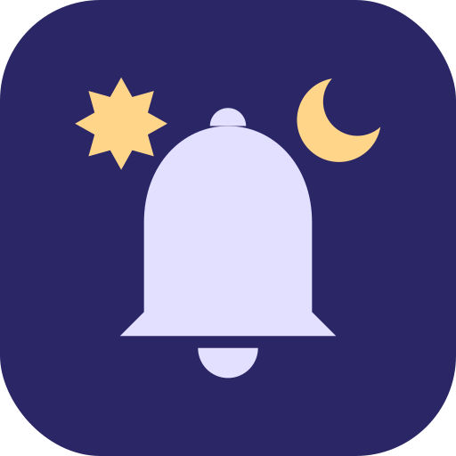
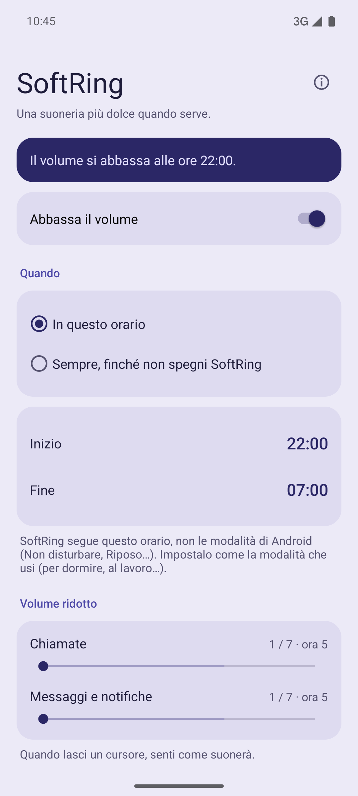
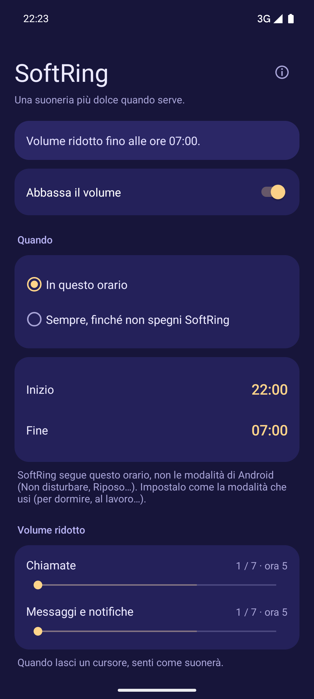
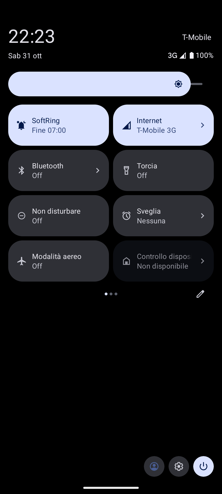
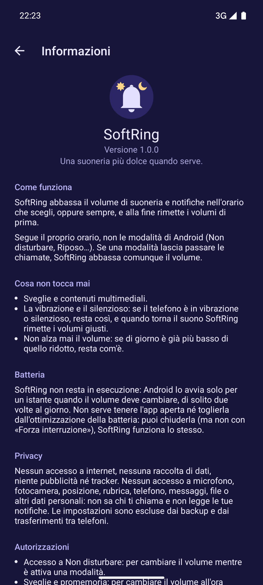

# SoftRing

[English](README.md) · **Italiano**

[](LICENSE)


[](#privacy)
[](#autorizzazioni)



**SoftRing** è una piccola app Android che **abbassa il volume di suoneria e notifiche**
nelle ore che scegli, di notte (preimpostato 22:00–07:00), al lavoro o sempre, e alla
fine rimette i volumi di prima, senza toccare sveglie e contenuti multimediali. È un
programmatore di volume per le ore di quiete che lavora insieme alle modalità di Android
(“Non disturbare”, “Riposo”…).

È software libero, senza accesso a internet, pubblicità, tracker o librerie di terze
parti, e chiede solo cinque autorizzazioni. Le release sono compilate, firmate e
verificate da GitHub Actions, e le build sono progettate per essere riproducibili.

<p align="center">
  <a href="fastlane/metadata/android/it-IT/images/phoneScreenshots/1.png"></a>
  <a href="fastlane/metadata/android/it-IT/images/phoneScreenshots/2.png"></a>
  <a href="fastlane/metadata/android/it-IT/images/phoneScreenshots/3.png"></a>
  <a href="fastlane/metadata/android/it-IT/images/phoneScreenshots/4.png"></a>
</p>

## Perché

Non disturbare e le modalità permettono di scegliere *chi* può raggiungerti di notte.
Non scelgono *a che volume*: quando un contatto autorizzato chiama alle 3, il telefono
suona al volume pieno del giorno e ti sveglia di soprassalto.

SoftRing si occupa del volume. Segue l'orologio, non le modalità di Android, quindi
funziona allo stesso modo con una o più modalità, e il volume è ridotto solo nelle ore
che scegli.

---

## Indice

- [Funzioni](#funzioni)
- [Requisiti](#requisiti)
- [Installazione](#installazione)
  - [Aggiornamento](#aggiornamento)
- [Utilizzo](#utilizzo)
- [Modalità e Non disturbare](#modalità-e-non-disturbare)
- [Autorizzazioni](#autorizzazioni)
- [Privacy](#privacy)
- [Verifica](#verifica)
- [Limiti noti](#limiti-noti)
- [Compilazione dai sorgenti](#compilazione-dai-sorgenti)
- [Traduzioni](#traduzioni)
- [Struttura del progetto](#struttura-del-progetto)
- [Versioni](#versioni)
- [Licenza e disclaimer](#licenza-e-disclaimer)

---

## Funzioni

- **Orario a scelta** (preimpostato 22:00–07:00), anche a cavallo della mezzanotte o
  di giorno, **oppure sempre**: volume ridotto finché non lo spegni, per esempio in
  ufficio.
- **Due volumi ridotti**: uno per le chiamate, uno per messaggi e notifiche.
- **Senti prima**: quando rilasci un cursore, la suoneria o il suono di notifica suona
  per un attimo a quel livello (da Android 9).
- **Solo verso il basso**: un volume del giorno già più basso di quello notturno
  resta com'è.
- **Volumi diurni ripristinati** automaticamente al mattino.
- **Resiste a un riavvio**, anche prima del primo sblocco del telefono.
- **Funziona anche con le modalità**: se una modalità (Non disturbare, Riposo, Alla
  guida…) lascia passare le chiamate, SoftRing abbassa comunque il volume.
- **Consumo trascurabile**: SoftRing non resta in esecuzione. Android lo avvia solo per
  un istante quando il volume deve cambiare, di solito due volte al giorno.
- **Riquadro nelle Impostazioni rapide**: vedi a colpo d'occhio se SoftRing è attivo,
  e fino a quando, e lo accendi o spegni con un tocco, a telefono sbloccato. Android lo
  aggiunge piccolo: per vedere anche la seconda riga ("Fine 07:00"), allargalo dalla
  modifica delle Impostazioni rapide.
- **Il volume di sveglie e contenuti multimediali non viene mai modificato.**
- Le suonerie personalizzate, per esempio quella di un contatto, restano le stesse:
  SoftRing cambia solo il volume, mai i suoni.
- **Vibrazione e silenzioso sono rispettati**: se il telefono è in vibrazione o
  silenzioso, viene lasciato così com'è, e lo stato lo segnala.
- Tema chiaro e scuro secondo il sistema, nei colori dell'icona: lavanda di giorno,
  indaco di notte.
- English, Italiano, Français, Deutsch, Español.

## Requisiti

- Android 8.0 (API 26) o successivo, su qualsiasi telefono: con o senza i servizi
  Google, con il sistema originale del produttore o con sistemi alternativi come
  GrapheneOS, LineageOS e molti altri.

## Installazione

**Obtainium** (aggiornamenti direttamente dalle release di GitHub): aggiungi l'app con
questo URL

```
https://github.com/nidamanx/softring
```

**F-Droid**: in arrivo.

**A mano**: scarica `softring-<versione>.apk` dall'
[ultima release](https://github.com/nidamanx/softring/releases/latest) e aprilo sul
telefono.

### Aggiornamento

Obtainium e F-Droid segnalano le nuove versioni. Un'installazione manuale si aggiorna
installando l'APK della nuova release sopra quello vecchio: le impostazioni restano.
Ogni versione è firmata con la stessa chiave (vedi [Verifica](#verifica)).

## Utilizzo

1. Apri SoftRing. Parte **spento**: non cambia nulla finché non lo attivi.
2. In "Quando" scegli **In questo orario** e imposta inizio e fine (preimpostato:
   22:00–07:00), oppure **Sempre**.
3. Imposta il volume ridotto per le chiamate e per messaggi e notifiche. Quando rilasci
   un cursore senti come suonerà.
4. Attiva "Abbassa il volume". Compare una scheda per ogni autorizzazione ancora da
   concedere: toccala e consenti l'autorizzazione nella schermata di sistema.

Fatto: SoftRing cambia il volume all'inizio e alla fine dell'orario, anche dopo un
riavvio, oppure lo tiene ridotto finché non lo spegni con "Sempre". Se sposti un
cursore mentre il volume è ridotto, il nuovo livello vale subito.

## Modalità e Non disturbare

SoftRing segue **il proprio orario**, non le modalità di Android. Le modalità (Non
disturbare, Riposo, Alla guida e tutte quelle che crei) possono avere qualsiasi nome e
qualsiasi regola, quindi un'app non può sapere quale significa "sto dormendo".

Imposta l'orario di SoftRing come quello della modalità che usi per dormire. Se dormi
di giorno, imposta per esempio Inizio 10:00 e Fine 17:00. La fascia oraria è una sola,
uguale ogni giorno. SoftRing abbassa la suoneria mentre dormi; per il silenzio
completo usa invece il silenzioso o una modalità.

## Autorizzazioni

SoftRing **non ha accesso a internet** e chiede solo queste autorizzazioni:

| Autorizzazione | Perché |
|---|---|
| Avvio all'accensione (`RECEIVE_BOOT_COMPLETED`) | Riapplicare l'orario notturno dopo un riavvio |
| Accesso a Non disturbare (`ACCESS_NOTIFICATION_POLICY`) | Mentre una modalità è attiva, Android permette di cambiare il volume solo alle app con questo accesso. Usato solo per il volume: le modalità non vengono mai lette né modificate. Facoltativo se non usi modalità |
| Servizio in primo piano (`FOREGROUND_SERVICE`, `FOREGROUND_SERVICE_SPECIAL_USE`) | Da Android 17, Android cambia il volume solo per un'app aperta o con un servizio in primo piano. SoftRing avvia il servizio all'orario scelto o dal riquadro, cambia il volume e lo chiude subito. Nessuna notifica permanente. Non usato fino ad Android 16 |
| Sveglie e promemoria (`SCHEDULE_EXACT_ALARM`) | Cambiare il volume all'ora esatta; senza, Android può ritardarlo. **Da Android 17 è necessaria**: senza, SoftRing non può cambiare il volume quando l'app è chiusa |

La build fallisce automaticamente se l'APK chiede qualsiasi altra autorizzazione
(vedi `config/allowed-permissions.txt`).

## Privacy

SoftRing non raccoglie nulla, non invia nulla e non contiene pubblicità, statistiche
né librerie di terze parti. Gli unici dati che conserva, sul telefono, sono le tue
impostazioni e i volumi diurni da ripristinare al mattino. Per proteggere la tua
privacy, questi dati non vengono inclusi nei backup del telefono né copiati su un
telefono nuovo: dopo un ripristino SoftRing riparte da zero. Vedi
[PRIVACY.md](PRIVACY.md).

SoftRing **non ha accesso** a microfono, fotocamera, posizione, rubrica, telefono,
messaggi, file o qualsiasi altro dato personale. Non sa chi ti chiama e non legge le
tue notifiche. Usa solo:

- **il volume** di suoneria e notifiche, per abbassarlo e ripristinarlo;
- **le sveglie**, per fare il cambio all'orario giusto, anche dopo un riavvio;
- **l'accesso a Non disturbare**, solo perché Android permette di cambiare il volume
  durante una modalità unicamente alle app che ce l'hanno;
- **la tua suoneria e il suono di notifica**, solo per farti sentire un'anteprima
  quando sposti un cursore;
- **un servizio in primo piano**, solo su Android 17 e successivi e solo per il tempo
  del cambio di volume (meno di un secondo): da quella versione Android ignora i cambi
  di volume chiesti da un'app che non è aperta.

Puoi verificarlo: il codice è pubblico, e la build fallisce se l'app chiede qualsiasi
altra autorizzazione.

## Verifica

Ogni release è compilata da GitHub Actions a partire dal codice sorgente del tag. Sono
disponibili tre controlli indipendenti.

**1. Certificato di firma.** È lo stesso per ogni versione. Confrontalo con
[AppVerifier](https://github.com/soupslurpr/AppVerifier) o con Obtainium.

```
io.github.nidamanx.softring
79:57:C1:B2:4A:CC:AE:E6:30:A9:FA:F8:28:02:FE:18:36:EC:1D:B9:7D:2F:2C:80:F3:B4:67:03:46:2E:BF:9A
```

**2. Checksum del file.** Ogni release include `SHA256SUMS`:

```
sha256sum -c SHA256SUMS
```

**3. Provenienza della build.** Un'attestazione firmata dimostra che l'APK è stato
prodotto dal workflow di release di questo repository a partire da un commit preciso:

```
gh attestation verify softring-<versione>.apk --repo nidamanx/softring
```

Le build sono progettate per essere riproducibili: F-Droid compila l'app dai sorgenti sui propri server e la
distribuisce solo se il risultato è identico all'APK pubblicato qui.

Per segnalare un problema di sicurezza, vedi [SECURITY.md](SECURITY.md).

## Limiti noti

- Su alcuni dispositivi il volume della suoneria e quello delle notifiche sono
  collegati dal sistema: in questo caso il valore "Chiamate" vale per entrambi.
- Se all'inizio o alla fine dell'orario il telefono è in vibrazione o silenzioso,
  SoftRing non lo tocca e aspetta che torni il suono: se ne accorge entro 15 minuti. Per
  non aspettare, apri l'app oppure spegni e riaccendi SoftRing dal riquadro nelle
  Impostazioni rapide.
- Se revochi "Sveglie e promemoria", o fai l'arresto forzato dell'app, Android
  cancella i cambi di volume programmati senza avvisarlo. Apri SoftRing una volta per
  farlo ripartire.

## Compilazione dai sorgenti

Requisiti: JDK 17 e Android SDK.

```
./gradlew test lintRelease assembleRelease
```

Il risultato è un APK non firmato in `app/build/outputs/apk/release/`.

## Traduzioni

I testi dell'app sono in `app/src/main/res/values-*/strings.xml`, quelli degli store
in `fastlane/metadata/android/*/`. Le correzioni sono benvenute.

## Struttura del progetto

```
softring/
├── app/        l'app (Kotlin, solo API della piattaforma) e i suoi test
├── art/        icona e banner degli store
├── config/     le sole autorizzazioni che l'APK può chiedere
├── docs/       note per chi mantiene il progetto
├── fastlane/   testi e schermate degli store per lingua, changelog in inglese
├── fdroid/     bozza della ricetta di build per F-Droid
├── keystore/   impronta della chiave di release, chiave di debug pubblica
├── scripts/    script usati dai controlli automatici
└── .github/    workflow di GitHub Actions
```

## Versioni

Il progetto segue il [Semantic Versioning](https://semver.org/lang/it/). La versione
(`versionName`, e `versionCode` per Android) è in `app/build.gradle.kts` e compare in
Impostazioni → App → SoftRing. Ogni release ha un tag Git `vX.Y.Z`, e le modifiche di
ogni versione sono elencate in [CHANGELOG.md](CHANGELOG.md).

## Licenza e disclaimer

Copyright (C) 2026 Nicola Davide Mannarelli ([@nidamanx](https://github.com/nidamanx))

Questo programma è software libero: puoi ridistribuirlo e/o modificarlo secondo i
termini della **GNU Affero General Public License** pubblicata dalla Free Software
Foundation, nella versione 3 della licenza o (a tua scelta) in qualsiasi versione
successiva (`SPDX-License-Identifier: AGPL-3.0-or-later`). Vedi il file
[LICENSE](LICENSE): il testo della licenza che ha valore legale è quello inglese.

**Citazione.** Se usi questa app, o parti del suo codice, nel tuo lavoro o in un altro
progetto, ti chiedo di citare *SoftRing* di Nicola Davide Mannarelli con un link a
questo repository. Il pulsante **Cite this repository** di GitHub, generato da
[CITATION.cff](CITATION.cff), fornisce una citazione pronta. La licenza richiede già che
le copie ridistribuite o modificate mantengano l'avviso di copyright.

**Disclaimer.** Questo software è fornito "così com'è", senza garanzie di alcun tipo,
esplicite o implicite. In nessun caso l'autore potrà essere ritenuto responsabile di
reclami, danni o altre responsabilità, comprese chiamate o notifiche perse, derivanti
dall'uso o dall'uso improprio di questo software. Sei l'unico responsabile di come lo
usi e di verificare che i volumi impostati siano adatti alle tue esigenze. Questa è una
traduzione di cortesia: fa fede il testo inglese.
