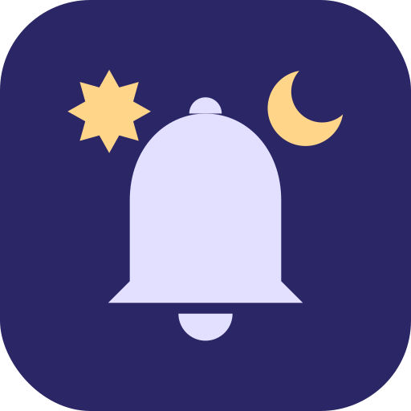
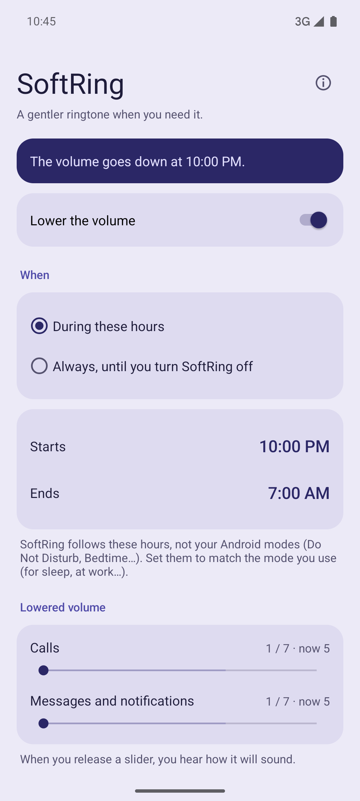
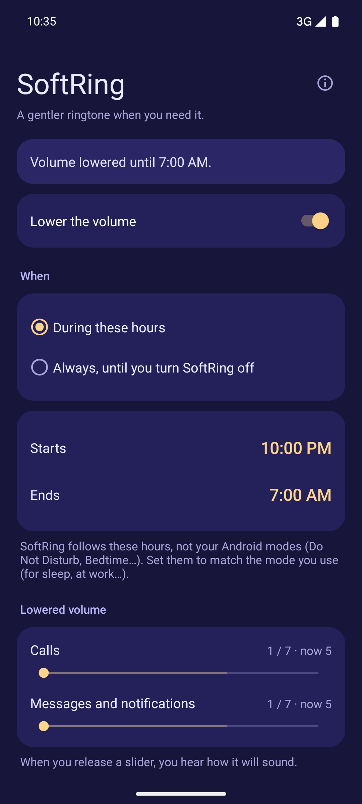
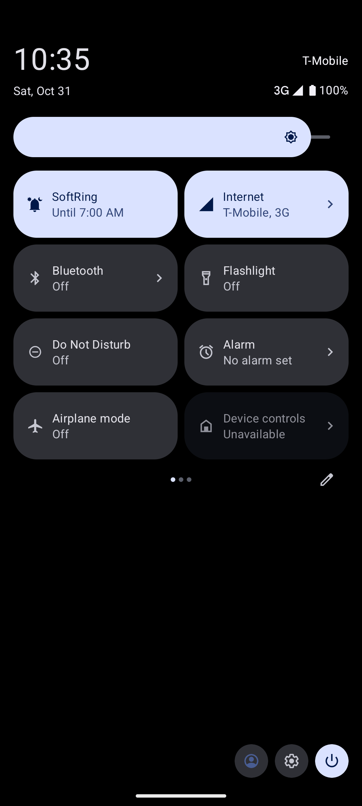
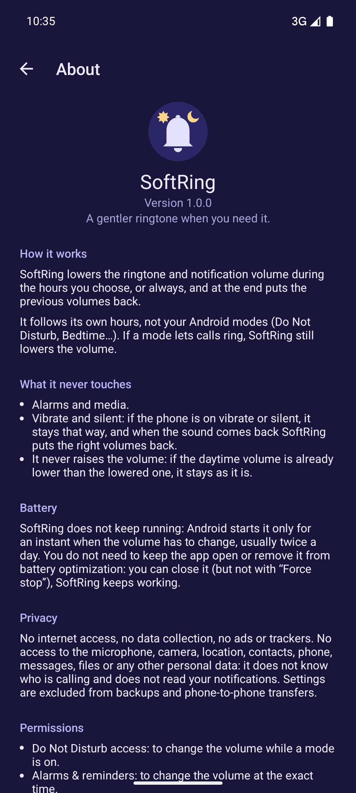

# SoftRing

**English** · [Italiano](README.it.md)

[](LICENSE)


[](#privacy)
[](#permissions)



**SoftRing** is a small Android app that **lowers the ringtone and notification volume**
whenever you want: during the hours you choose, every day, or until you turn it off.
Then it puts the previous volumes back, without touching alarms or media. It is a
quiet-hours volume scheduler that works alongside Android modes (“Do Not Disturb”,
“Bedtime”…).

It is free software, with no internet access, no ads, no trackers and no third-party
libraries. It asks only for what it needs to change the volume at the right time, and
explains why for each permission. Releases are built, signed and verified by GitHub
Actions, and the builds are designed to be reproducible.

<p align="center">
  <a href="https://apps.obtainium.imranr.dev/redirect?r=obtainium://add/https://github.com/nidamanx/softring"></a>
  
  <a href="https://github.com/nidamanx/softring/releases/latest"></a>
</p>

Signing certificate, to check with [AppVerifier](https://github.com/soupslurpr/AppVerifier)
or [Obtainium](https://github.com/ImranR98/Obtainium) ([other checks](#verifying)):

```
io.github.nidamanx.softring
79:57:C1:B2:4A:CC:AE:E6:30:A9:FA:F8:28:02:FE:18:36:EC:1D:B9:7D:2F:2C:80:F3:B4:67:03:46:2E:BF:9A
```

<p align="center">
  <a href="fastlane/metadata/android/en-US/images/phoneScreenshots/1.png"></a>
  <a href="fastlane/metadata/android/en-US/images/phoneScreenshots/2.png"></a>
  <a href="fastlane/metadata/android/en-US/images/phoneScreenshots/3.png"></a>
  <a href="fastlane/metadata/android/en-US/images/phoneScreenshots/4.png"></a>
</p>

## Why

Do Not Disturb and modes let you choose *who* can reach you at night. They do not
choose *how loud*: when an allowed contact calls at 3 AM, the phone rings at full
daytime volume and wakes you with a start.

SoftRing takes care of the volume. It is driven by the clock, not by Android modes,
so it works the same with one mode or many, and the volume is lowered only during the
hours you choose.

---

## Contents

- [Features](#features)
- [Requirements](#requirements)
- [Installation](#installation)
  - [Updating](#updating)
  - [Verifying](#verifying)
- [Usage](#usage)
- [Modes and Do Not Disturb](#modes-and-do-not-disturb)
- [Permissions](#permissions)
- [Privacy](#privacy)
- [Known limitations](#known-limitations)
- [Building from source](#building-from-source)
- [Translations](#translations)
- [Project layout](#project-layout)
- [Versioning](#versioning)
- [License and disclaimer](#license-and-disclaimer)

---

## Features

- **Hours you choose**, also across midnight or during the day, **or always**: lowered
  until you turn it off, for example at the office.
- **Two lowered volumes**: one for calls, one for messages and notifications.
- **Hear it first**: when you release a slider, the ringtone or notification sound
  plays briefly at that level (Android 9 and later).
- **Only lowers**: a daytime volume that is already lower than the night volume is
  left as it is.
- **Daytime volumes restored** automatically in the morning.
- **Survives a reboot**, even before the phone is unlocked for the first time.
- **Works with your modes**: if a mode (Do Not Disturb, Bedtime, Driving…) lets calls
  ring, SoftRing still lowers the volume.
- **Negligible battery use**: SoftRing does not keep running. Android starts it only
  for an instant when the volume has to change, usually twice a day.
- **Quick Settings tile**: see at a glance whether SoftRing is on, and until when,
  and switch it on or off with a tap, with the phone unlocked. Android adds it small: to also see the second
  line ("Until 07:00"), make it wider when editing the Quick Settings.
- **Alarm and media volumes are never changed.**
- Custom ringtones, for example one set for a contact, stay the same: SoftRing
  changes only the volume, never the sounds.
- **Vibrate and silent are respected**: if the phone is on vibrate or silent, it is
  left as it is, and the status says so.
- Light and dark theme following the system, in the colors of the icon: lavender by
  day, indigo by night.
- English, Italiano, Français, Deutsch, Español.

## Requirements

- Android 8.0 (API 26) or later, on any phone: with or without Google services, with
  the maker's original system or with alternative systems such as GrapheneOS,
  LineageOS and many others.

## Installation

**[Obtainium](https://github.com/ImranR98/Obtainium)** (updates straight from GitHub releases): add the app with this URL

```
https://github.com/nidamanx/softring
```

**F-Droid**: coming soon.

**Manually**: download `softring-<version>.apk` from the
[latest release](https://github.com/nidamanx/softring/releases/latest) and open it on
the phone.

### Updating

Obtainium and F-Droid notify you of new versions. A manual install is updated by
installing the APK of the new release over the old one: settings are kept. Every
version is signed with the same key (see [Verifying](#verifying)).

### Verifying

Every release is built by GitHub Actions from the tagged source code. Three
independent checks are available.

**1. Signing certificate.** It is the same for every version. Compare it with
[AppVerifier](https://github.com/soupslurpr/AppVerifier) or with [Obtainium](https://github.com/ImranR98/Obtainium).

```
io.github.nidamanx.softring
79:57:C1:B2:4A:CC:AE:E6:30:A9:FA:F8:28:02:FE:18:36:EC:1D:B9:7D:2F:2C:80:F3:B4:67:03:46:2E:BF:9A
```

The same certificate is also published on the author's website, a source independent
of GitHub: [ndmnet.eu](https://www.ndmnet.eu/en/skills.html#open-source-tools).

**2. File checksum.** Each release includes `SHA256SUMS`:

```
sha256sum -c SHA256SUMS
```

**3. Build provenance.** A signed attestation proves the APK was produced by this
repository's release workflow from a specific commit:

```
gh attestation verify softring-<version>.apk --repo nidamanx/softring
```

Builds are designed to be reproducible: F-Droid builds the app from source on its own servers and
distributes it only if the result is identical to the APK published here.

To report a security problem, see [SECURITY.md](SECURITY.md).

## Usage

1. Open SoftRing. It starts **switched off**: nothing changes until you turn it on.
2. Under "When", choose **During these hours** and set start and end, or
   **Always**.
3. Set the lowered volume for calls and for messages and notifications. When you
   release a slider you hear how it will sound.
4. Turn on "Lower the volume". A card appears for each permission still to be
   granted: tap it and allow the permission in the system screen.

That is all: SoftRing changes the volume at the start and at the end of the hours,
also after a reboot, or keeps it lowered until you turn it off with "Always".
Changing a slider while the volume is lowered applies it immediately.

## Modes and Do Not Disturb

SoftRing follows **its own hours**, not your Android modes. Modes (Do Not Disturb,
Bedtime, Driving and any you create) can have any name and any rule, so an app cannot
tell which one means "I am sleeping".

Set SoftRing's hours to match the mode you use for sleep. If you sleep during the day,
set for example Starts 10:00 and Ends 17:00. There is one time range, the same every
day. SoftRing lowers the ringtone while you sleep; for complete silence, use silent
mode or a mode instead.

## Permissions

SoftRing has **no internet access** and requests only these permissions:

| Permission | Why |
|---|---|
| Run at startup (`RECEIVE_BOOT_COMPLETED`) | Re-apply the night hours after a reboot |
| Do Not Disturb access (`ACCESS_NOTIFICATION_POLICY`) | While a mode is on, Android lets only apps with this access change the volume. Used only for the volume: modes are never read or changed. Optional if you do not use modes |
| Foreground service (`FOREGROUND_SERVICE`, `FOREGROUND_SERVICE_SPECIAL_USE`) | From Android 17, Android changes the volume only for an app that is open or has a foreground service. SoftRing starts the service at the chosen time or from the tile, changes the volume and stops it at once. No persistent notification. Not used up to Android 16 |
| Alarms & reminders (`SCHEDULE_EXACT_ALARM`) | Change the volume at the exact time; without it Android may delay it. **Required from Android 17**: without it, SoftRing cannot change the volume while the app is closed |

The build fails automatically if the APK ever requests anything else
(see `config/allowed-permissions.txt`).

## Privacy

SoftRing collects nothing, sends nothing, and contains no ads, analytics or
third-party libraries. The only data it keeps, on the phone, are your settings and
the daytime volumes to restore in the morning. To protect your privacy, these data are
not included in phone backups nor copied to a new phone: after a restore SoftRing
starts from scratch. See [PRIVACY.md](PRIVACY.md).

SoftRing has **no access** to your microphone, camera, location, contacts, phone,
messages, files or any other personal data. It does not know who is calling and does
not read your notifications. It only uses:

- **the volume** of ringtone and notifications, to lower it and restore it;
- **alarms**, to make the change at the right time, also after a reboot;
- **Do Not Disturb access**, only because Android allows volume changes during a
  mode just to apps that have it;
- **your ringtone and notification sound**, only to play a short preview when you
  move a slider;
- **a foreground service**, only on Android 17 and later and only for the time of the
  volume change (less than a second): from that version Android ignores volume
  changes requested by an app that is not open.

You can check it: the source is public, and the build fails if the app ever requests
another permission.

## Known limitations

- On some devices the ringtone and notification volumes are linked by the system: in
  that case the "Calls" value applies to both.
- If the phone is on vibrate or silent when the hours start or end, SoftRing leaves it
  alone and waits for the sound to come back: it notices within 15 minutes. To skip the
  wait, open the app or turn SoftRing off and on again from its Quick Settings tile.
- If you revoke "Alarms & reminders", or force stop the app, Android cancels its
  scheduled volume changes without telling it. Open SoftRing once to start it again.

## Building from source

Requirements: JDK 17 and the Android SDK.

```
./gradlew test lintRelease assembleRelease
```

The result is an unsigned APK in `app/build/outputs/apk/release/`.

## Translations

App texts are in `app/src/main/res/values-*/strings.xml`, store texts in
`fastlane/metadata/android/*/`. Corrections are welcome.

## Project layout

```
softring/
├── app/        the app (Kotlin, platform APIs only) and its unit tests
├── art/        icon, store banner and install badges
├── config/     the only permissions the APK may request
├── docs/       notes for maintainers
├── fastlane/   store texts and screenshots per language, changelogs in English
├── fdroid/     draft of the F-Droid build recipe
├── keystore/   signing certificate fingerprints
├── scripts/    scripts used by the automated checks
└── .github/    GitHub Actions workflows
```

## Versioning

The project follows [Semantic Versioning](https://semver.org/). The version
(`versionName`, and `versionCode` for Android) is in `app/build.gradle.kts` and is
shown in Settings → Apps → SoftRing. Every release has a Git tag `vX.Y.Z`, and the
changes of each version are listed in [CHANGELOG.md](CHANGELOG.md).

## License and disclaimer

Copyright (C) 2026 Nicola Davide Mannarelli ([@nidamanx](https://github.com/nidamanx))

This program is free software: you can redistribute it and/or modify it under the
terms of the **GNU Affero General Public License** as published by the Free Software
Foundation, either version 3 of the License, or (at your option) any later version
(`SPDX-License-Identifier: AGPL-3.0-or-later`). See the [LICENSE](LICENSE) file.

**Credit.** If you use this app, or parts of its code, in your work or in another
project, please credit *SoftRing* by Nicola Davide Mannarelli and link to this
repository. The **Cite this repository** button on GitHub, generated from
[CITATION.cff](CITATION.cff), gives a ready-made citation. The license already requires
redistributed and modified copies to keep the copyright notice.

**Disclaimer.** This software is provided "as is", without warranty of any kind,
express or implied. In no event shall the author be liable for any claim, damages or
other liability, including missed calls or notifications, arising from the use or
misuse of this software. You alone are responsible for how you use it and for checking
that the volumes it sets suit your needs.
